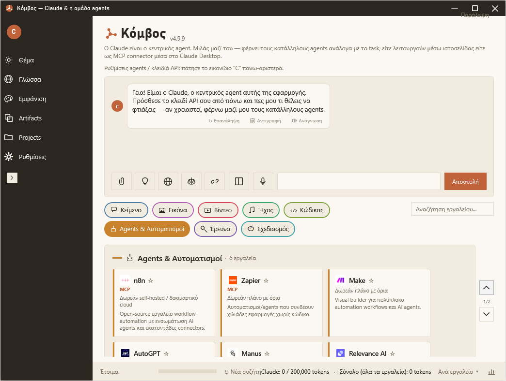
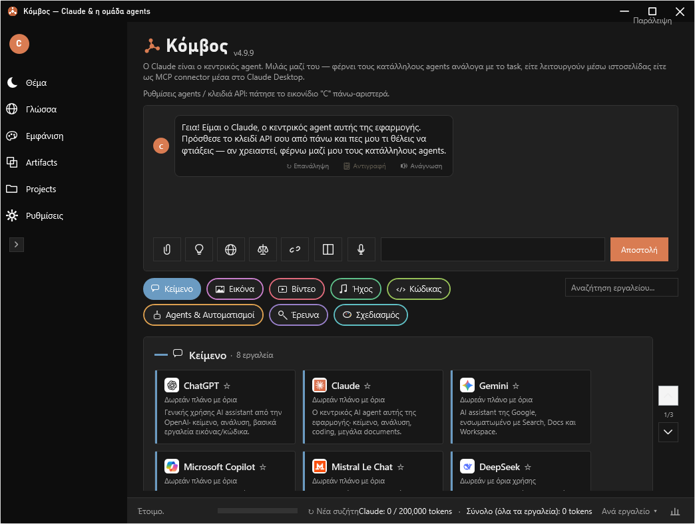

<p align="center"></p>

<p align="center"><a href="https://github.com/gs-applabs/Kombos/releases/latest"></a> <a href="https://github.com/gs-applabs/Kombos/releases"></a> <a href="https://github.com/gs-applabs/Kombos/actions/workflows/windows-ci.yml"></a> <a href="https://github.com/gs-applabs/Kombos/actions/workflows/product-snapshots.yml"></a></p>

<p align="center"><a href="docs/GS-APP-LABS-FAQ.md">FAQ / Συχνές ερωτήσεις</a> · <a href="https://github.com/gs-applabs/Kombos/issues/new/choose">Feedback / Προτάσεις</a></p>

<p align="center"><strong>Connect AI agents, organize projects and discover tools from a local Windows hub.</strong><br/>Όλα τα εργαλεία AI, σε έναν κόμβο.</p>

<p align="center"><a href="https://github.com/gs-applabs/Kombos/releases/latest"></a> <a href="docs/SHOWCASE.md"></a></p>

<p align="center"><a href="#at-a-glance--με-μια-ματιά">Overview / Επισκόπηση</a> · <a href="#full-documentation--αναλυτική-τεκμηρίωση">Full documentation / Τεκμηρίωση</a> · <a href="https://github.com/gs-applabs/Kombos/issues">Support / Υποστήριξη</a> · <a href="https://github.com/gs-applabs">GS App Labs</a></p>

## Visual showcase / Οπτική παρουσίαση

<table>
<tr>
<td width="50%" valign="top"><a href="docs/SHOWCASE.md"></a><br/><sub>Theme 0 · agents</sub></td>
<td width="50%" valign="top"><a href="docs/SHOWCASE.md"></a><br/><sub>Theme 1 · text</sub></td>
</tr>
</table>

**[Explore 22 screenshots / Εξερεύνηση στιγμιοτύπων](docs/SHOWCASE.md)** · [Original capture index](docs/product-snapshots/README.md) · [Media kit](https://github.com/gs-applabs/gs-applabs/tree/main/assets/showcase)

<sub>Actual UI previews from development commit `a41c5ab27dc7`; may differ from the latest published installer. / Πραγματικές εικόνες συγκεκριμένου build ανάπτυξης, ενδέχεται να διαφέρουν από τη δημοσιευμένη έκδοση.</sub>

## At a glance / Με μια ματιά

| | What you can do / Τι μπορείς να κάνεις |
|---|---|
| **Agents / Βοηθοί** | Multi-agent chat, comparison and handoff / Συνομιλία και συνεργασία agents |
| **Workflows / Ροές** | Projects, prompts, plugins and local gateway / Projects, prompts και επεκτάσεις |
| **Control / Έλεγχος** | Local API-key storage and configurable providers / Τοπική αποθήκευση κλειδιών και επιλογή παρόχων |

### Get started / Ξεκίνημα

For the newest installer always use [latest published release](https://github.com/gs-applabs/Kombos/releases/latest). Version-specific links below are retained as reference. / Για τη νεότερη έκδοση χρησιμοποίησε τον σύνδεσμο τελευταίας δημοσιευμένης έκδοσης.

- **Installer:** [KombosSetup-4.9.9.exe](https://github.com/gs-applabs/Kombos/releases/download/v4.9.9/KombosSetup-4.9.9.exe) · [SHA-256](https://github.com/gs-applabs/Kombos/releases/download/v4.9.9/KombosSetup-4.9.9.exe.sha256)
- **Requirements / Απαιτήσεις:** Windows · .NET 11 Desktop Runtime · provider credentials for online services.
- **What's new / Νέα έκδοση:** Migration to .NET 11 and plugin/link security hardening. / Μετάβαση σε .NET 11 και ενίσχυση ασφάλειας.
- **Known limits / Όρια:** Online AI providers require their own credentials and may charge fees. Physical Windows and live provider integrations are not universally verified. / Οι πάροχοι μπορεί να χρεώνουν και δεν έχουν επαληθευτεί όλες οι διασυνδέσεις.

See the [published release](https://github.com/gs-applabs/Kombos/releases/tag/v4.9.9) for verification details. Review installation prompts and compare the checksum before running the installer. / Δείτε τις σημειώσεις έκδοσης και επαληθεύστε το SHA-256 πριν από την εγκατάσταση.

---

## Full documentation / Αναλυτική τεκμηρίωση

<p align="center"></p>

<h1 align="center">Κόμβος (Kombos)</h1>

<p align="center"><b>v4.9.9</b> · WPF · .NET 11 · EL / EN / FR / DE · <a href="../../releases/latest">Λήψη / Download</a> · <a href="#η-οικογένεια-opsis--the-opsis-family">Η οικογένεια Opsis</a></p>

Ένας τοπικός κόμβος (hub) για εργαλεία τεχνητής νοημοσύνης στα Windows — στο κέντρο του βρίσκεται μια
συνομιλία με τον Claude (ή όποιον άλλο agent προτιμήσεις), που ξέρει τον κατάλογο 39+ εργαλείων AI και
σου φέρνει τα κατάλληλα ανάλογα με το task σου. Δωρεάν, ανοιχτού κώδικα, με τα κλειδιά API σου
κρυπτογραφημένα τοπικά και χωρίς καμία τηλεμετρία.

*A local Windows hub for AI tools, with Claude as the central agent that ties them together — see the [English section](#english) below.*

## Περιεχόμενα / Contents

- [Ελληνικά](#ελληνικά)
- [English](#english)
- [Άδεια / License](#άδεια--license)

## Ελληνικά

### Λειτουργίες

| Ενότητα | Τι κάνει |
|---|---|
| 💬 Συνομιλία & agents | Πραγματική σύνδεση με το Anthropic Messages API (Claude), ή οποιονδήποτε agent του καταλόγου με OpenAI-compatible endpoint (ChatGPT, Mistral, DeepSeek, Grok, Gemini) ως κεντρικό agent· ορατό extended thinking, αναζήτηση στο διαδίκτυο, επισύναψη εικόνων/αρχείων, απομακρυσμένοι MCP servers, prompt caching |
| ⚖ Σύγκριση & Handoff | Το ίδιο ερώτημα σε όλους τους agents ταυτόχρονα· pipeline όπου ένας agent γράφει πρόχειρο και ένας δεύτερος το βελτιώνει· διακλάδωση (Fork) συζήτησης από οποιοδήποτε μήνυμα |
| 🧰 Κατάλογος εργαλείων | 39+ εργαλεία σε 8 κατηγορίες (Κείμενο, Εικόνα, Βίντεο, Ήχος, Κώδικας, Agents & Αυτοματισμοί, Έρευνα, Σχεδιασμός) με λογότυπα, περιγραφές, καρφίτσωμα αγαπημένων, αναζήτηση σε όλες τις κατηγορίες και σύνδεσμο "Πρόσθεσε στο Claude Desktop (MCP)" |
| 🧠 Μνήμη & Projects | Projects με ομαδοποίηση συζητήσεων, Project Memory (ευρετήριο αρχείων + `/readfile`, `/verify`, `/search`), Hive Memory (ό,τι μαθαίνει ένας agent το ξέρουν όλοι), Presets/Personas, Βιβλιοθήκη Prompts, Shared Projects μέσω φακέλου συγχρονισμού |
| 🔌 Plugins | Σύστημα plugins με `AssemblyLoadContext` isolation, γκαλερί "Λήψη & Ενσωμάτωση", Plugin SDK με οδηγό "Νέο Plugin", Nexus Marketplace (από φάκελο ή Git URL) και 5 επίσημα πακέτα (Dev / Office / Business / Creative Toolkit, Weather) με εντολές `/κάτι` που τρέχουν τοπικά με μηδενικό κόστος tokens |
| 🌐 Kombos Gateway | Τοπική πύλη (`http://127.0.0.1:PORT/v1/chat/completions`, OpenAI-compatible) για VS Code, Cursor, Claude Code κ.ά., με αυτόματο fallback στον επόμενο ρυθμισμένο agent όταν ο πρώτος αποτύχει· ακούει ΜΟΝΟ στο 127.0.0.1 |
| 🔁 Αυτόματη συνέχιση | Όταν ο Claude πλησιάζει το όριό του, η συζήτηση συνεχίζει σε άλλον agent που έχεις ήδη ρυθμίσει — η φούσκα δείχνει πάντα ποιος απάντησε |
| ⚡ Kombos Anywhere | Ctrl+Alt+Space ανοίγει μικρή μπάρα quick-capture από οπουδήποτε στα Windows· Ctrl+Alt+K φέρνει το κύριο παράθυρο· Ctrl+K παλέτα εντολών |
| 🎤 Φωνή | Ανάγνωση απαντήσεων (τοπικό text-to-speech) και φωνητική εισαγωγή push-to-talk — χωρίς cloud |
| 🖼 Εικόνες & Artifacts | `/image` (δημιουργία εικόνας μέσα στη συζήτηση), Artifacts panel με όλα τα code blocks, ζωντανή προεπισκόπηση HTML/SVG/Markdown |
| 👥 Συνεργασία & δεδομένα | Συγχρονισμός συζητήσεων μέσω κοινού φακέλου (OneDrive/Dropbox/δίκτυο) σε πραγματικό χρόνο, συζήτηση σε ξεχωριστό παράθυρο, εισαγωγή από ChatGPT/Claude.ai (`conversations.json`), εξαγωγή/εισαγωγή JSON, τοπικό dashboard χρήσης tokens |
| 🎨 Εμφάνιση | Φωτεινό / Σκούρο / Σύστημα (ουδέτερο charcoal), 7 skins (Modern, Windows Vista/7/8/10-11, Classic, Nexus), 10 κινούμενα φόντα, ρυθμιζόμενη διαφάνεια, προσβάσιμο μέγεθος κειμένου, πτυσσόμενη πλευρική μπάρα, Focus mode (F11) |
| 🔒 Ασφάλεια | Κλειδιά API κρυπτογραφημένα με Windows DPAPI (δεμένα στον λογαριασμό χρήστη)· χειροκίνητος έλεγχος ενημερώσεων, ποτέ αθόρυβη λήψη/εγκατάσταση· καμία τηλεμετρία |

Επίσης: πλήρης μετάφραση σε 4 γλώσσες (Ελληνικά, English, Français, Deutsch), οδηγός πρώτης εκκίνησης,
tray icon με λειτουργία στο παρασκήνιο, και αυτόματα tests (DPAPI, αποθήκευση ρυθμίσεων/συζητήσεων, Gateway).

### Οδηγός, οικογένεια Opsis και ενημερώσεις (v4.9.0)
- **Οδηγός καλωσορίσματος** σε κάθε νέα μείζονα/ελάσσονα έκδοση (και από Ρυθμίσεις → Βοήθεια / εικονίδιο tray): Επόμενο/Πίσω, «Να μην εμφανιστεί ξανά», Esc/βελάκια. Όταν κλείνει, μικραίνει και πετάει μέσα στο κινούμενο εικονίδιο της εφαρμογής.
- **Η οικογένεια Opsis**: κάρτες για τις εφαρμογές της σουίτας με πραγματικά εικονίδια, κατάσταση εγκατάστασης (Εγκατεστημένο / Δεν είναι εγκατεστημένο / Διαθέσιμη ενημέρωση), Άνοιγμα, **Λήψη / Ενημέρωση** και Λεπτομέρειες. Η λήψη ζητά πάντα επιβεβαίωση (αρχείο, μέγεθος, πηγή), επαληθεύει SHA-256 και **αρνείται** σε ασυμφωνία· ο installer δεν εκτελείται ποτέ αυτόματα.
- **Ενημέρωση του Κόμβου**: ειδοποίηση νέας έκδοσης (tray balloon + μήνυμα μέσα στο παράθυρο), μία φορά ανά έκδοση, με διακόπτη στις Ρυθμίσεις → Ενημερώσεις· το κουμπί **«Εγκατάσταση τώρα»** κατεβάζει το `KombosSetup-<έκδοση>.exe` του release, ελέγχει το SHA-256 (αρνείται αν λείπει ή δεν ταιριάζει), ξεκινά τον κανονικό installer (έγκριση διαχειριστή από τα Windows) και κλείνει την εφαρμογή. Log: `%AppData%\Kombos\logs`.

#### Απόρρητο: τι δικτυακά αιτήματα γίνονται
Καμία τηλεμετρία. Το μόνο: (1) `GET api.github.com/repos/gs-applabs/Kombos/releases/latest` μετά από ~30 δευτ. και κάθε 24 ώρες (με ETag), (2) το πολύ μία φορά το 24ωρο το αρχείο καταλόγου `raw.githubusercontent.com/gs-applabs/Opsis/master/suite/apps.json` (https, μόνο GitHub, έως 256 KB, επικυρώνεται), (3) όταν ανοίγεις τη βιτρίνα, το `releases/latest` κάθε εφαρμογής της σουίτας. Κάθε αίτημα αποτυγχάνει σιωπηλά αν δεν υπάρχει δίκτυο.

### Στιγμιότυπα οθόνης / Screenshots

<table>
<tr>
<td><br/><sub>Κύρια οθόνη, σκούρο θέμα / Main window, dark</sub></td>
<td><br/><sub>Κύρια οθόνη, φωτεινό θέμα / Main window, light</sub></td>
</tr>
<tr>
<td><br/><sub>Η οικογένεια Opsis (πραγματικά εικονίδια, κατάσταση εγκατάστασης) / The Opsis family</sub></td>
<td><br/><sub>Η οικογένεια Opsis, φωτεινό / The Opsis family, light</sub></td>
</tr>
<tr>
<td><br/><sub>Οδηγός καλωσορίσματος / Welcome guide</sub></td>
<td><br/><sub>Ρυθμίσεις / Settings</sub></td>
</tr>
</table>

### Εγκατάσταση

1. Κατέβασε το `KombosSetup-<έκδοση>.exe` και το αντίστοιχο `.sha256` από τα [Releases](../../releases/latest).
2. Επαλήθευσε το αρχείο (PowerShell): `(Get-FileHash .\KombosSetup-<έκδοση>.exe -Algorithm SHA256).Hash` — πρέπει να ταιριάζει με το περιεχόμενο του `.sha256`.
3. Εκτέλεσέ το (εγκαθιστά για όλους τους χρήστες στο `Program Files` και ζητά έγκριση διαχειριστή· μια παλιά per-user εγκατάσταση μεταφέρεται αυτόματα, οι ρυθμίσεις μένουν). Απαιτήσεις: Windows 10/11 x64, [.NET 11 Desktop Runtime](https://dotnet.microsoft.com/download/dotnet/11.0).

Άλλες εφαρμογές της ίδιας σειράς: **Η οικογένεια Opsis** (Ρυθμίσεις → Βοήθεια).

Ο installer προσφέρει προαιρετική συντόμευση επιφάνειας εργασίας και εκκίνηση με τα Windows. Χρειάζεσαι δικό σου
κλειδί API (π.χ. από [console.anthropic.com](https://console.anthropic.com)) — μπαίνει στις Ρυθμίσεις → Agent,
κρυπτογραφημένο τοπικά, ποτέ σε καθαρό κείμενο.

### Χτίσιμο από τον πηγαίο κώδικα

```
dotnet build
dotnet run
```

Το εκτελέσιμο βγαίνει στο `bin/Debug/net11.0-windows/Kombos.exe`. Για installer:

```
dotnet publish Kombos.csproj -c Release -r win-x64 --self-contained false -o publish
ISCC.exe installer/Kombos.iss
```

Το τελικό `KombosSetup-<έκδοση>.exe` καταλήγει στο `installer/output/`. Tests: `dotnet test Kombos.Tests`.

### Δομή αποθετηρίου

```
Kombos.csproj                   Κύριο project (.NET 11, WPF + WinForms για το tray icon)
MainWindow.xaml(.cs)            UI + κύρια λογική chat/κατάλογος
SettingsWindow / AgentSettingsWindow / AppearanceWindow   Ρυθμίσεις, agents, εμφάνιση
Themes/                         Light / Dark / Icons (vector εικονίδια)
Models/, Data/Catalog.cs        Μοντέλα δεδομένων και ο κατάλογος εργαλείων
Services/                       ClaudeClient, OpenAiCompatibleClient, GatewayServer, SettingsStore,
                                ConversationStore, DpapiProtector, PluginLoader, UpdateChecker, ...
Localization/L.cs               Όλα τα strings σε 4 γλώσσες + Ιστορικό εκδόσεων
Plugins/IKombosPlugin.cs        Contract για plugins τρίτων
plugins-src/                    Πηγαίος κώδικας των επίσημων plugins (ξεχωριστά .csproj)
Kombos.Tests/                   Unit tests (xUnit)
installer/                      Script εγκατάστασης (Inno Setup)
```

Plugins τρίτων: βάλε τον φάκελο του plugin (με το .dll του) στο `%AppData%\Kombos\plugins\` και κάνε
επανεκκίνηση· δες το `plugins-src/KombosWeather` για πλήρες παράδειγμα. Το πλήρες ιστορικό αλλαγών
είναι στο [CHANGELOG.md](CHANGELOG.md).

## English

A local Windows hub for AI tools. At its center is a chat with Claude (or any other agent you prefer)
that knows a catalog of 39+ AI tools and brings in the right ones for your task. Free, open source,
with your API keys encrypted locally and no telemetry whatsoever.

### Features

| Area | What it does |
|---|---|
| 💬 Chat & agents | Real Anthropic Messages API integration (Claude), or any catalog agent with an OpenAI-compatible endpoint (ChatGPT, Mistral, DeepSeek, Grok, Gemini) as the central agent; visible extended thinking, web search, image/file attachments, remote MCP servers, prompt caching |
| ⚖ Compare & Handoff | Send one question to every agent at once; a pipeline where one agent drafts and a second refines; fork a conversation from any message |
| 🧰 Tool catalog | 39+ tools in 8 categories (Text, Image, Video, Audio, Code, Agents & Automation, Research, Design) with logos, descriptions, pinned favorites, cross-category search and an "Add to Claude Desktop (MCP)" link |
| 🧠 Memory & Projects | Projects grouping conversations, Project Memory (file index + `/readfile`, `/verify`, `/search`), Hive Memory (what one agent learns, all agents know), Presets/Personas, Prompt Library, Shared Projects via a sync folder |
| 🔌 Plugins | Plugin system with `AssemblyLoadContext` isolation, a "Download & Install" gallery, a Plugin SDK with a "New Plugin" wizard, Nexus Marketplace (from a folder or Git URL) and 5 official packs (Dev / Office / Business / Creative Toolkit, Weather) with `/something` commands that run locally at zero token cost |
| 🌐 Kombos Gateway | A local OpenAI-compatible gateway (`http://127.0.0.1:PORT/v1/chat/completions`) for VS Code, Cursor, Claude Code etc., with automatic fallback to the next configured agent when the first fails; listens on 127.0.0.1 ONLY |
| 🔁 Automatic continuation | When Claude nears its limit, the conversation continues on another agent you already configured — the reply bubble always shows who answered |
| ⚡ Kombos Anywhere | Ctrl+Alt+Space opens a mini quick-capture bar from anywhere in Windows; Ctrl+Alt+K summons the main window; Ctrl+K is the command palette |
| 🎤 Voice | Read-aloud (local text-to-speech) and push-to-talk voice input — no cloud |
| 🖼 Images & Artifacts | `/image` (generate an image inside the conversation), an Artifacts panel with every code block, live HTML/SVG/Markdown preview |
| 👥 Collaboration & data | Real-time conversation sync through a shared folder (OneDrive/Dropbox/network), detach a conversation into its own window, import from ChatGPT/Claude.ai (`conversations.json`), JSON export/import, local token-usage dashboard |
| 🎨 Appearance | Light / Dark / System (neutral charcoal), 7 skins (Modern, Windows Vista/7/8/10-11, Classic, Nexus), 10 animated backgrounds, adjustable transparency, accessible text size, collapsible sidebar, Focus mode (F11) |
| 🔒 Security | API keys encrypted with Windows DPAPI (tied to your Windows account); manual update check, never a silent download/install; no telemetry |

Also: full translation in 4 languages (Greek, English, French, German), a first-run guide, a system-tray
icon with background operation, and automated tests (DPAPI, settings/conversation storage, Gateway).

### Guide, Opsis family and updates (v4.9.0)
- **Welcome guide** on every new major/minor version (also from Settings → Help or the tray icon): Next/Back, "Don't show again", Esc/arrow keys. When it closes it shrinks and flies into the app's own animated icon.
- **The Opsis family**: a card per suite app with real icons, install state (Installed / Not installed / Update available), Open, **Download / Update** and Details. Downloads always ask first (file, size, source), verify SHA-256 and **refuse** on mismatch; the installer is never run automatically.
- **Updating Kombos**: new-version notice (tray balloon + in-window toast), once per version, with a switch in Settings → Updates; **"Install now"** downloads the release's `KombosSetup-<version>.exe`, verifies its SHA-256 (refuses if missing or different), starts the normal installer (Windows administrator approval) and closes the app. Log: `%AppData%\Kombos\logs`.

#### Privacy: what goes over the network
No telemetry. Only: (1) `GET api.github.com/repos/gs-applabs/Kombos/releases/latest` after ~30 s and every 24 h (ETag), (2) at most once a day the catalogue file `raw.githubusercontent.com/gs-applabs/Opsis/master/suite/apps.json` (https, GitHub hosts only, max 256 KB, validated), (3) when you open the showcase, each suite app's `releases/latest`. Every request fails silently when offline.

### Screenshots

<table>
<tr>
<td><br/><sub>Main window, dark</sub></td>
<td><br/><sub>The Opsis family (real icons, install state)</sub></td>
</tr>
<tr>
<td><br/><sub>Welcome guide</sub></td>
<td><br/><sub>Main window, light</sub></td>
</tr>
</table>

### Installation

1. Download `KombosSetup-<version>.exe` and its `.sha256` from the [latest release](../../releases/latest).
2. Verify it (PowerShell): `(Get-FileHash .\KombosSetup-<version>.exe -Algorithm SHA256).Hash` — it must match the `.sha256` file.
3. Run it (installs for all users into `Program Files` and asks for administrator approval; an older per-user install is migrated automatically, your settings are kept). Requirements: Windows 10/11 x64, the [.NET 11 Desktop Runtime](https://dotnet.microsoft.com/download/dotnet/11.0).

More apps from the same family: **The Opsis family** (Settings → Help).

Download the latest `KombosSetup-*.exe` from [Releases](../../releases) and run it. It needs no
administrator rights and offers an optional desktop shortcut and start-with-Windows. Requires the
[.NET 11 Desktop Runtime](https://dotnet.microsoft.com/download/dotnet/11.0). You need your own API key
(e.g. from [console.anthropic.com](https://console.anthropic.com)) — it goes into Settings → Agent,
encrypted locally, never stored in plain text.

### Building from source

```
dotnet build
dotnet run
```

The executable lands in `bin/Debug/net11.0-windows/Kombos.exe`. For the installer:

```
dotnet publish Kombos.csproj -c Release -r win-x64 --self-contained false -o publish
ISCC.exe installer/Kombos.iss
```

The final `KombosSetup-<version>.exe` lands in `installer/output/`. Tests: `dotnet test Kombos.Tests`.

### Repository layout

See the Greek section above for the annotated tree. Third-party plugins: drop the plugin folder (with
its .dll) into `%AppData%\Kombos\plugins\` and restart; see `plugins-src/KombosWeather` for a complete
example. The full change history is in [CHANGELOG.md](CHANGELOG.md).

## Άδεια / License

Το Kombos διατίθεται με άδεια **MIT** — δες το αρχείο [LICENSE](LICENSE). Copyright (c) 2026 gs-applabs.

*Kombos is released under the **MIT License** — see [LICENSE](LICENSE). Copyright (c) 2026 gs-applabs.*

Τα κλειδιά API που εισάγεις χρησιμοποιούνται με δική σου ευθύνη· κάθε χρέωση γίνεται στον δικό σου
λογαριασμό στον αντίστοιχο πάροχο. Τα εργαλεία/agents τρίτων που εμφανίζονται στον κατάλογο δεν ανήκουν
ούτε ελέγχονται από αυτή την εφαρμογή. Το Kombos Gateway είναι εμπνευσμένο από την ιδέα του ανοιχτού
κώδικα [OmniRoute](https://github.com/diegosouzapw/OmniRoute) (MIT)· δεν αντιγράφηκε κώδικας.

*API keys you enter are used at your own risk; any charges go to your own account with the respective
provider. Third-party tools/agents shown in the catalog are neither owned nor controlled by this
application. Kombos Gateway is inspired by the idea behind the open-source
[OmniRoute](https://github.com/diegosouzapw/OmniRoute) (MIT); no code was copied.*

**Το λογισμικό παρέχεται "ΩΣ ΕΧΕΙ", χωρίς καμία εγγύηση. / Provided "AS IS", without warranty of any kind.**

### Third-party notices / Άδειες τρίτων

Kombos uses .NET (MIT) and the `System.Speech` package (MIT). The icons shown in "The Opsis family" are the icons of the respective apps of the same author, embedded as local resources. Product names and logos in the tools catalogue belong to their owners. / Το Kombos χρησιμοποιεί .NET (MIT) και το πακέτο `System.Speech` (MIT)· τα εικονίδια της οικογένειας Opsis είναι των αντίστοιχων εφαρμογών του ίδιου δημιουργού, ενσωματωμένα τοπικά· τα ονόματα/λογότυπα του καταλόγου ανήκουν στους ιδιοκτήτες τους.
